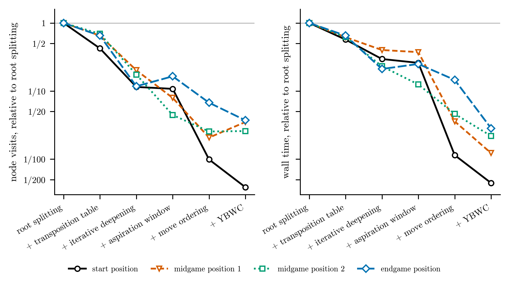
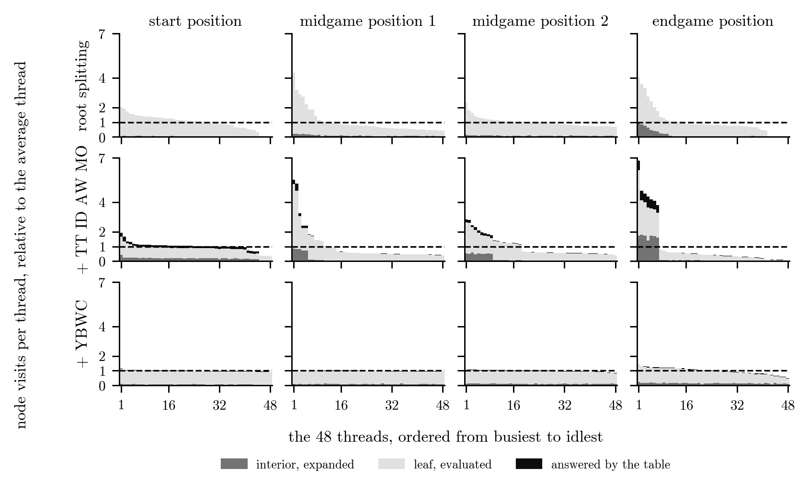
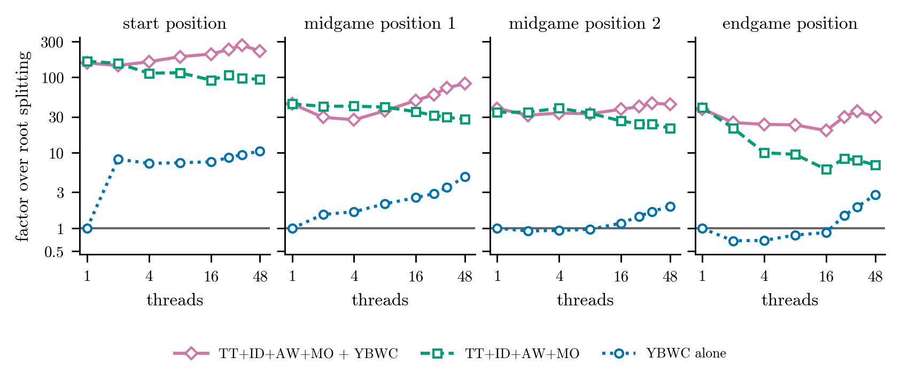

# Parallel game-tree search on SuperMUC-NG

Parallel alpha-beta search for the board game Abalone in C++ and OpenMP, on a SuperMUC-NG node with two 24-core Intel Xeon Platinum 8174. A parallel search which splits its work at the root is extended by five optimizations, one at a time, so that every gain stays attributable. They are a lockless shared transposition table, iterative deepening, an aspiration window, move ordering and the Young Brothers Wait Concept (YBWC), which also splits below the root. At 48 threads the complete engine is 35 to 225 times faster than root splitting on four test positions, and 400 to 2500 times faster than sequential alpha-beta on one core. The optimizations which shrink the tree also remove the parallelism of root splitting, and YBWC restores it. Each result below is explained by a measured mechanism, from counters inside the search or from the hardware counters, which LIKWID reads. Every search variant returns exactly the value of a plain minimax search at the same depth. For the table versions this holds in a build whose table only answers probes of equal depth.

| Step | Result | Mechanism |
|---|---|---|
| Alpha-beta, 1 core | 7.3x to 45.7x fewer leaves than minimax at depth 4, same value | the first move searched produces 17% of the cutoffs at the start position and 84% at the endgame, measured at depth 5 |
| Root splitting, 48 threads | 8.4x over one thread on midgame position 1, 11.2x at the endgame | bounded at 12.2 and 12.0 by the largest root subtree, which one thread has to search alone |
| + transposition table | 1.6x over root splitting | node visits fall from 19.4 to 12.6 million, and 25% of the verified hits are on entries another thread wrote |
| + iterative deepening | 2.5x | the previous depth names the move to try first, and cutoffs on the first move rise from 69% to 86% |
| + aspiration window | 2.7x | a window around the previous value lets more subtrees fall outside it, and node visits fall from 3.9 to 1.5 million |
| + move ordering | 27.9x | the table move, two killer moves per ply, the move type and a shared history counter put the refutation first in 97% of cutoffs, up from 54% |
| + YBWC | 81.8x | splitting below the root brings the busiest of 48 threads from 5.5 to 1.0 times the average thread |

*From the transposition table on, the optimizations are cumulative, on midgame position 1 at depth 5 and 48 threads, medians of five repetitions. Each factor is against root splitting at 48 threads, and each counter is taken at 48 threads.*



*Node visits (left) and wall time (right) after each optimization is added, as a fraction of root splitting on the same position, depth 5, 48 threads, medians of five repetitions.*

<details>
<summary>Node visits and wall time of every version on all four positions</summary>

**Node visits [million]**

| Version | start | midgame 1 | midgame 2 | endgame |
|---|--:|--:|--:|--:|
| alpha-beta, 1 core | 17.2 | 14.7 | 8.49 | 1.73 |
| root splitting, 48 threads | 37.5 | 19.4 | 10.8 | 1.86 |
| + transposition table | 15.9 | 12.6 | 7.46 | 1.21 |
| + iterative deepening | 4.30 | 3.92 | 1.88 | 0.218 |
| + aspiration window | 4.04 | 1.54 | 0.479 | 0.306 |
| + move ordering | 0.370 | 0.401 | 0.274 | 0.125 |
| + YBWC | 0.144 | 0.680 | 0.278 | 0.069 |
| move ordering alone | 0.519 | 1.32 | 0.751 | 0.145 |
| YBWC alone | 6.82 | 17.0 | 12.0 | 2.54 |

**Wall time [s]**

| Version | start | midgame 1 | midgame 2 | endgame |
|---|--:|--:|--:|--:|
| alpha-beta, 1 core | 33.1 | 34.6 | 17.0 | 2.92 |
| root splitting, 48 threads | 2.98 | 4.13 | 1.01 | 0.258 |
| + transposition table | 1.70 | 2.55 | 0.625 | 0.168 |
| + iterative deepening | 0.878 | 1.65 | 0.233 | 0.054 |
| + aspiration window | 0.771 | 1.54 | 0.126 | 0.064 |
| + move ordering | 0.034 | 0.148 | 0.046 | 0.038 |
| + YBWC | 0.013 | 0.050 | 0.022 | 0.007 |
| move ordering alone | 0.049 | 0.240 | 0.062 | 0.028 |
| YBWC alone | 0.284 | 0.853 | 0.512 | 0.094 |

Depth 5, medians of five repetitions. A node visit is an interior node whose moves were generated, a leaf handed to the evaluation, or a node the table answered. The last two rows carry one optimization alone on root splitting.

</details>

## Findings

**Search efficiency against parallel speedup.** The optimizations remove exactly the node visits which root splitting distributes over the threads. In the thread sweep on midgame position 1, the four optimizations before YBWC make the search 44x faster than root splitting at one thread but only 28x faster at 48 threads. With YBWC added, the factor rises from 45x to 83x instead. Move ordering makes almost every root move cut at once, so the remaining work collapses into a few root subtrees which one thread each has to search. The busiest thread then does 5.5 times the work of the average thread, against 4.3 without the optimizations. At the endgame, 41 root moves meet 48 threads, so seven threads get no work whatever the ordering does.



*Node visits of each of the 48 threads within one search, relative to the average thread of that search, split into interior nodes, leaves and table answers. Rows are cumulative, TT transposition table, ID iterative deepening, AW aspiration window, MO move ordering. Each panel is the repeat with the median wall time of five.*

**Isolated against cumulative ablation.** Move ordering and YBWC also run alone on root splitting, which separates what each does by itself from what it adds to the others. Ordering alone removes 93% of the node visits on midgame position 1, and on top of the table, deepening and the window it still removes 74%. It overlaps with the table but is not made redundant by it. YBWC alone is 4.8x faster than root splitting there, and 2.9x faster on top of the other four.

**A bound on root splitting, computed from the tree.** Root splitting cannot finish before its largest root subtree has been searched, and one thread searches it alone. The node visits of the 48-thread search divided by those of its largest root subtree therefore bound the speedup, at 12.2 on midgame position 1 and 12.0 at the endgame. Root splitting reaches 8.4x and 11.2x over one thread, so at the endgame it delivers 93% of the bound. YBWC alone reaches 40.6x and 31.4x on the same positions, well past the bound.

**Superlinear speedup from negative search overhead.** YBWC alone reaches 117.6x on 48 threads at the start position. At one thread it visits 17.23 million nodes, exactly the tree of the sequential search, and at 48 threads 6.82 million, a search overhead of −60%. The root value equals the sequential value in every repeat. In parallel a strong move late in the generated order can finish early and publish its bound into the shared window of its node. Every brother started afterwards then searches a narrower window than the sequential search had at the same place.



*Wall time of root splitting divided by that of the optimized version at the same thread count, depth 5, medians of three repetitions. TT+ID+AW+MO is the search with the first four optimizations.*

**A shared table without locks.** All threads share one table of 2<sup>23</sup> entries of 16 bytes, four to a cache line and none straddling two. Value, depth, bound, best move and writing thread are packed into one 64-bit word, and the key is stored exclusive-ored with that word, following Hyatt and Mann. A probe that reads a key and a word from two different writes fails the check by construction, so the table needs no lock. The share of verified hits written by another thread rises from 25% to 98% as the optimizations shrink the tree. The threads therefore use one result set rather than 48 private caches. LIKWID shows 0.21 branches per instruction at 48 threads, 2.4% of them mispredicted without the table and 2.5% with it. The table therefore removes node visits without making a node more expensive. Most of its benefit arrives far below the default size, with 18.5 million visits at 256 KiB, 13.3 million at 16 MiB and 12.6 million at 128 MiB.

**Table size and memory latency.** A Zobrist-indexed probe is a random access. The table grows from 256 KiB, which fits in L2, to 1 GiB, far beyond the 66 MiB of L3 on both sockets. The node rate of the table version still rises from 4.66 to 5.05 million per second. With 48 threads in flight, the probe latency of one thread overlaps the work of the others. Close and spread thread placement at 24 threads differ by at most 7% in wall time, so the table stays on the socket of the thread which allocates it. Cycles per instruction (CPI) are 1.09 at 24 threads on one socket and 1.47 at 48 threads. Both stay within 1% with and without the table, so the table adds no cost per instruction.

**Iterative deepening and the aspiration window.** Every iteration is its own parallel region, and the shallow iterations cannot fill 48 threads. With deepening, the table version scales only 2.0x from one to 48 threads on midgame position 1, against 8.7x without it. It still pays off by 2.5x net, because the node visits it removes outweigh the scaling it loses. The aspiration window removes 61% and 75% of the visits on the two midgame positions and 6% at the start position. At the endgame it adds 40%, since the value swings past the window between iterations and the re-searches are not repaid on the small tree.

**Node visits against wall time.** YBWC raises the node visits on midgame position 1 by 69%, from 0.40 to 0.68 million, and still cuts the wall time 2.9x. Time is node visits times time per visit, and YBWC lowers the second factor by keeping every thread busy. The split depth follows the same logic. Splitting every node with a remaining depth of 3 or more, instead of 4 or more, is 2.5x faster on midgame position 1 and 3.1x at the endgame. The 48 threads need the extra split points.

## Implementation

- **Root splitting.** One OpenMP task per root move, each with its own board and evaluator, and the sequential alpha-beta below the root. All tasks share the root alpha, a cache-line-aligned atomic raised with a compare-and-swap loop, so a strong early result narrows the window of every task started after it.
- **YBWC.** A node with a remaining depth of 3 or more searches its eldest child first and then spawns the younger brothers as nested tasks. They share a per-node atomic alpha, clamped below beta at every read, and a flag which stops the remaining brothers once one of them cuts.
- **Best move after a split.** A move searched in a window it failed low on returns only an upper bound, which can equal the exact maximum. Every split records the window of each move, and on a tie the move whose score lies inside its window wins. The value never depends on the finishing order of the threads, and with this rule the returned move always reaches that value.
- **Hashing.** The Zobrist key of a position is updated per move instead of being recomputed over the 61 fields.
- **Move ordering.** Moves are scored once and selected on demand instead of sorted. Killers are per thread. The history counters are shared relaxed atomics without synchronization, because a stale read only weakens an ordering hint and never changes a value.
- **Measurement driver.** `src/driver/abtest.cpp` runs one strategy on one position at a fixed depth and prints the value, the move, the time and the per-thread counters. Every strategy is linked into the same binary, so a comparison differs in the strategy and in nothing else.
- **Timed engine.** `src/engine/timed_engine.cpp` plays real games with all five optimizations under the referee's clock. It spends a fixed share of its remaining clock per move, which decays geometrically and never reaches zero, and halves it while behind on time. It keeps the table for the whole game, plays a short checked opening, and uses a defensive evaluation anchored to its own color so that the evaluation stays antisymmetric. It is not part of any measurement.

## Correctness

- `tests/` compares every search with plain minimax, which prunes nothing, at the same depth. The value has to be equal for every position, depth 2 to 4, 1 to 8 threads and every repeat.
- The table versions run in an equal-depth build for this comparison. With the standard rule, an entry from a deeper search may answer a shallower probe, so the root value can differ from the fixed-depth minimax value without being wrong. The equal-depth build only uses entries of the same remaining depth and has to match exactly. All measurements use the standard rule.
- A move check plays the returned move and searches the reply with the reference, which catches a correct value returned with a wrong move. It runs at depths 2 and 4 on 2 and 8 threads, where ties between a bound and the exact maximum occur.
- Unit checks compare the incremental Zobrist key with a full rebuild over 52,000 random moves covering all 13 move types. They also test packing and torn entries of the table, and the tie rule.
- At one thread, the values, moves and node counts of all nine measured strategies equal the cluster logs exactly. This covers all four positions at depth 5, built with clang and LLVM's OpenMP runtime. The suite pins the endgame counts of the seven strategies whose one-thread tree does not depend on the order in which the runtime runs queued tasks.
- The suite has 570 cases. Five defects are reintroduced one at a time, among them a missing side-to-move key, a fail-high stored as exact and a tie decided by the finishing order. Each fails between 1 and 21 cases of the quick subset.
- CI runs the quick suite under AddressSanitizer and UndefinedBehaviorSanitizer on every push. ThreadSanitizer ran on SuperMUC-NG over the root window, the table and the nested tasks at 4, 16 and 48 threads. It reported 8 races, all inside Intel's OpenMP runtime and none in this code. CI repeats the race check with LLVM's OpenMP runtime on every push.
- On the cluster, before any timing, 96 configurations of root splitting from 1 to 48 threads returned the sequential value in every repeat. So did 224 configurations of the cumulative and isolated versions, the table versions in the equal-depth build.

## Method

- **Hardware.** SuperMUC-NG batch nodes held exclusively, 2 sockets of Intel Xeon Platinum 8174 (Skylake-SP) with 24 cores each, running at 1.9 GHz, which LIKWID confirms. 48 threads run on the 48 physical cores with `OMP_PLACES=cores` and `OMP_PROC_BIND=close`, and every run outside LIKWID prints its affinity mask, which shows one thread per core.
- **Tools.** Intel icpx 2025.3 with `-O3 -fno-omit-frame-pointer -qopenmp`, LIKWID 5.3.0 with the BRANCH, L3 and MEM groups, and ThreadSanitizer.
- **Timing.** One `bestMove` call timed with `omp_get_wtime`, at a fixed depth of 5 and with no clock in the search. Depth 5 takes the sequential search 3 to 35 s per position. The table is cleared inside the timed region, so every time of a table version includes the clear.
- **Counters.** Node visits, cutoffs and table hits are counted per thread in slots padded to a cache line and merged after the search. The counters therefore cause no false sharing, and the timing runs use the same binary.
- **Protocol.** Medians of five repetitions for the comparison of all versions and of three for the thread and parameter sweeps. In the comparison of all versions, a version at one thread runs once, since its tree is deterministic.
- **Metrics.** Speedup over one thread of the same version, the factor over root splitting at the same thread count, and search overhead as the change in node visits against one thread, following Feldmann. Load imbalance is the busiest thread over the average of all 48, idle ones included, and the root-splitting bound is the one derived above.

## Repository layout

```
.
├── src/
│   ├── framework/   board, moves, evaluation and the game programs of the Abalone framework
│   ├── search/      Zobrist hashing, lockless table, move generation, tie rule, counters
│   ├── sequential/  minimax and alpha-beta, the references
│   ├── parallel/    root splitting, the five cumulative versions and two optimizations in isolation
│   ├── engine/      timed engine for real games
│   └── driver/      measurement driver
├── tests/           minimax comparison, unit and move checks, mutation and race checks
├── studies/         SLURM sessions, raw logs, analysis scripts and figures
└── positions/       test positions
```

| Strategy | Source | Adds |
|---|---|---|
| `Minmax Seq Oracle` | `src/sequential/minimax.cpp` | the reference, no pruning |
| `AB Seq Oracle` | `src/sequential/alpha_beta.cpp` | alpha-beta pruning |
| `AB Parallel` | `src/parallel/root_splitting.cpp` | one task per root move, shared root window |
| `AB Par TT` | `src/parallel/cumulative/tt.cpp` | transposition table |
| `AB Par TT ID` | `src/parallel/cumulative/tt_id.cpp` | iterative deepening |
| `AB Par TT ID Asp` | `src/parallel/cumulative/tt_id_aw.cpp` | aspiration window |
| `AB Par TT ID Asp Ord` | `src/parallel/cumulative/tt_id_aw_mo.cpp` | move ordering |
| `AB Par TT ID Asp Ord YBW` | `src/parallel/cumulative/tt_id_aw_mo_ybwc.cpp` | YBWC |
| `AB Par Ord` | `src/parallel/isolated/mo.cpp` | move ordering alone |
| `AB Par YBW` | `src/parallel/isolated/ybwc.cpp` | YBWC alone |
| `AB Par TT ID Asp Ord YBW Clock` | `src/engine/timed_engine.cpp` | game clock, kept table, defensive evaluation |

`studies/README.md` maps the files to the working repository in which the measurements ran, and lists what changed in the code since.

## Building and running

```bash
# SuperMUC-NG with Intel oneAPI: driver and game programs into build/native/
make
export OMP_NUM_THREADS=48 OMP_PLACES=cores OMP_PROC_BIND=close
build/native/abtest "AB Par TT ID Asp Ord YBW" positions/position-midgame1 5 5   # strategy, position, depth, repeats

# a game with a referee clock of 60 s per side, the timed engine against alpha-beta at depth 4
build/native/player -p 3000 O &
build/native/player -p 4000 -s 2 X 4 &
build/native/referee -t 60 -p 3000 -p 4000

# any machine with a C++20 compiler and OpenMP: portable build, test suite, mutation check
make PORTABLE=1 test
python3 tests/mutation_check.py

# every figure and table from the raw logs, and every number quoted above
bash studies/regen_all.sh
python3 studies/readme_numbers.py
```

`build/native/abtest` without arguments lists the strategies, `player -h` lists them with their index. On macOS, Apple clang has no OpenMP, so the portable build needs `CXX=clang++` from Homebrew LLVM.

## References

1. D. E. Knuth and R. W. Moore, "An analysis of alpha-beta pruning," *Artificial Intelligence*, vol. 6, no. 4, pp. 293–326, 1975.
2. R. Feldmann, *Game Tree Search on Massively Parallel Systems*, PhD thesis, University of Paderborn, 1993.
3. R. M. Hyatt and T. Mann, "A lockless transposition-table implementation for parallel search," *ICGA Journal*, vol. 25, no. 1, pp. 36–39, 2002.
4. A. L. Zobrist, "A new hashing method with application for game playing," Technical Report 88, Computer Sciences Department, University of Wisconsin, 1970.
5. J. Schaeffer, "The history heuristic and alpha-beta search enhancements in practice," *IEEE Transactions on Pattern Analysis and Machine Intelligence*, vol. 11, no. 11, pp. 1203–1212, 1989.

## License

MIT, see `LICENSE`. The Abalone framework in `src/framework/` is by Josef Weidendorfer and keeps its own notices, with the game programs under the GPL version 2 or later.
